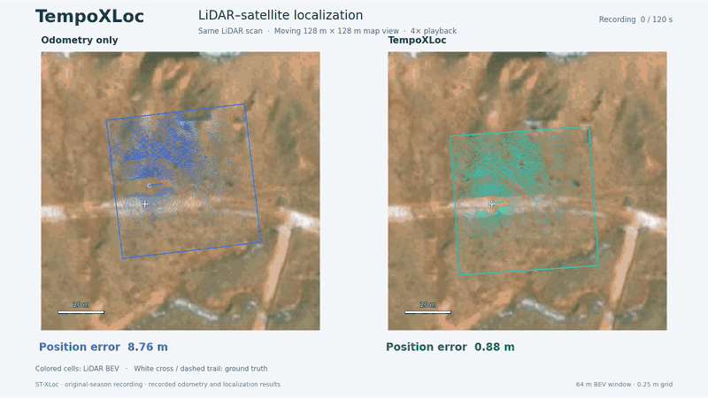
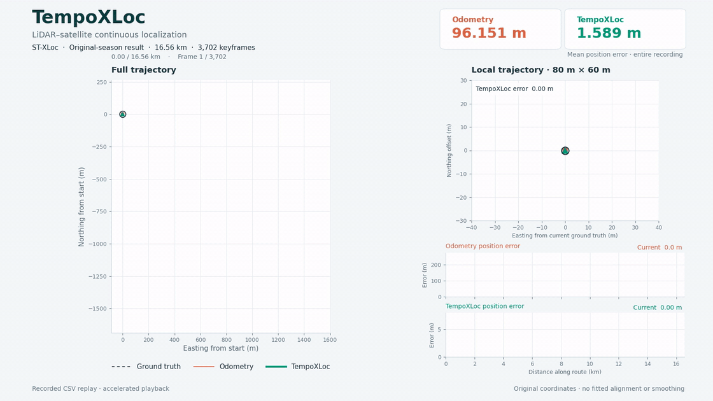

# TempoXLoc

**面向 GNSS 拒止环境车辆定位的多候选 LiDAR–卫星匹配与时序融合方法**

> **代码公开计划：论文录用后公开源代码、预训练权重和复现材料。**

[English](README.md)

TempoXLoc 将激光雷达点云编码为 BEV 图像，与卫星图像匹配以估计车辆位姿。HPPC 用于匹配阶段的多候选细化；时序融合结合匹配结果、里程计和历史位姿估计，实现连续定位。

## LiDAR–卫星图叠加

[30 秒 MP4 视频](assets/tempoxloc_bev_satellite.mp4) · [静态效果图](assets/tempoxloc_bev_satellite_poster.png)

选取约两分钟的连续行驶记录，以 **4 倍速播放 30 秒**。同一帧点云分别按纯里程计位姿（左侧**蓝色**）和 TempoXLoc 位姿（右侧**青色**）投影，两侧共享随车辆移动的 128 m × 128 m 局部卫星裁剪。白色十字与虚线表示真值。该片段用于展示定位矫正的效果，播放速度不代表网络推理速度。

## 完整路线

[完整路线 MP4 视频](assets/tempoxloc_stxloc_demo.mp4) · [静态轨迹图](assets/tempoxloc_stxloc_poster.png)

动画使用原季节 ST-XLoc 连续定位实验的已有结果，加速回放真值、运动学里程计和 TempoXLoc 轨迹。

| 完整 ST-XLoc 路线 · 16.56 km · 3,702 个关键帧 | 平均 ATE（m） | P95 ATE（m） |
|---|---:|---:|
| 运动学里程计 | 96.151 | 197.757 |
| TempoXLoc | **1.589** | **3.174** |

## 公开计划

当前仓库提供项目简介和可视化效果。源代码、模型权重、配置及复现材料将在论文录用后公开。

叠加演示中的卫星影像遵循原提供方的权属和使用条款；本仓库不分发完整卫星地图与激光雷达数据集。
